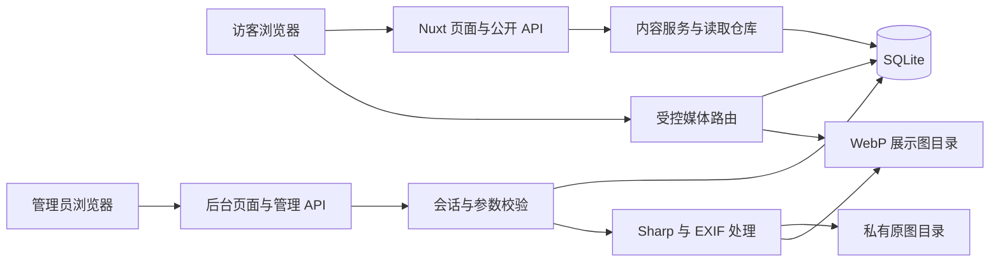

# PHOTO JOURNAL · 完整使用说明

快速了解项目请先看 [README](../README.md)。

一份以照片为主的个人影像日记，也留一点位置，写下快门之外的生活。

项目把 **首页、摄影集、关于我与个人动态、单管理员工作台** 放在同一个 Nuxt 应用中。照片独立展示，不按组图组织；文字可以很短，发布和整理都在后台完成。浅色是雨中荷塘，深色是星空，摄影与骑行转场为网站保留一点个人表达。

当前版本可在本地完整运行：账号、照片、分类、文案、动态与浏览量均保存到 SQLite 和本地磁盘。**阿里云 OSS/CDN、原图下载、多用户体系尚未接入**，不需要云服务密钥即可开始使用。

本说明对应当前开发分支 `feat/public-site`。

## 目录

- [功能一览](#功能一览)
- [技术架构](#技术架构)
- [快速开始](#快速开始)
- [使用后台](#使用后台)
- [照片处理与 EXIF](#照片处理与-exif)
- [浏览量与访问权限](#浏览量与访问权限)
- [主题与动效](#主题与动效)
- [环境配置](#环境配置)
- [目录结构](#目录结构)
- [常用命令与测试](#常用命令与测试)
- [构建与部署](#构建与部署)
- [备份恢复与升级](#备份恢复与升级)
- [接口概览](#接口概览)
- [常见问题](#常见问题)
- [当前边界与后续方向](#当前边界与后续方向)

## 功能一览

### 前台

| 页面或能力 | 当前行为 |
| --- | --- |
| 首页 | 可编辑引言、逐字入场与轻微呼吸动效、进入摄影集的入口；当前首页不展示照片列表 |
| 摄影集 | 全部公开照片平级瀑布流展示、顶部分类、分页加载；分类栏随页面滚走，不遮挡照片 |
| 照片查看 | 点击打开大图与 EXIF 面板，前后切换照片，支持 `?photo=<id>` 链接；竖图按可用视口容纳 |
| 关于我 | 作者头像、名称、介绍、个人签句，以及类似朋友圈的动态墙 |
| 个人动态 | 文字、多图、话题、发布时间与浏览量；公开内容按发布时间倒序显示，分页加载更早记录 |
| 主题 | 跟随系统、深色、浅色三档；记住当前浏览器的选择 |
| 背景特效 | 深色星空与流星；浅色水面、雨滴、荷花、荷叶、鱼虾、蜻蜓、白鹭与亭台；可单独关闭 |
| 页面转场 | 摄影集光圈展开、关于我骑行翻页；导航与背景保持连续 |
| 加载与异常 | 带斜向流光的骨架和图片占位、图片失败提示、错误重试、带矢量插画的空状态 |
| 响应式与无障碍 | 桌面与移动布局、可见键盘焦点、语义化控件、系统减少动态效果支持 |
| 页脚 | 统一页脚位置，预留可配置的备案号及查询链接 |

### 后台

- **照片管理**：批量选择或拖入图片，逐张处理；独立编辑、发布、撤回、分类和软删除。
- **批量操作**：多选发布、撤回、统一分类、移除；拖动调整摄影集顺序并自动保存，也支持卡片键盘排序。
- **重复反馈**：依据原始文件 SHA-256 识别完全相同的照片；改名仍可识别；重复上传或重复发布有明确提示。
- **分类管理**：新增、改名、排序、启用与停用。
- **动态工作台**：创建、编辑、保存草稿、公开或私密发布、添加话题、上传最多 9 张配图。
- **网站文案**：修改首页引言、入口文字、关于我的标题、签句、正文、作者名称、简介和头像。
- **操作反馈**：顶部短时通知、明确的发布状态、表单错误与加载保护。
- **管理员登录**：单管理员、密码哈希、服务端会话、退出与基础请求限流。

## 技术架构

这是一个包含服务端的全栈应用，前后台与 API 共用同一个 Node.js 进程。它不是仅靠静态 HTML 就能完整运行的相册：登录、上传、发布、私密权限与持久化统计都依赖服务端。

| 层级 | 技术与职责 |
| --- | --- |
| 应用框架 | Nuxt 4、Vue 3、TypeScript；页面、布局、路由与服务端渲染 |
| HTTP 服务 | Nitro / Nuxt Server Routes；公开读取、管理接口与受控媒体访问 |
| 数据存储 | Node 内置 `node:sqlite`；SQLite WAL、事务、内容与计数持久化 |
| 参数校验 | Zod；请求字段、发布状态、上传关联与分页参数校验 |
| 图片处理 | Sharp；尺寸校验、方向校正、WebP 多尺寸展示图 |
| EXIF | exifr 读取，白名单处理后对外展示 |
| 身份与密码 | `@node-rs/argon2` 的 Argon2id 密码哈希、随机会话令牌与 HttpOnly Cookie |
| 页面动效 | GSAP、ScrollTrigger、Lenis；文案入场、滚动与转场协调 |
| 特效绘制 | 原生 Canvas 2D；光圈转场使用 WebGL，兼容 Canvas 2D 回退 |
| 视觉控件 | 自定义 CSS / SVG；液态玻璃控件、主题角饰、图标与占位状态 |
| 自动化验证 | Vitest、Vue Test Utils、Happy DOM、Playwright / Chrome |



公开摄影内容通过 `ContentRepository` 读取，默认使用 SQLite；隔离的界面开发可切换到 fixture 仓库。动态、网站文案、管理员与实际上传仍由本地数据库管理。媒体处理集中在 `server/media/`，目前只有本地实现，没有已启用的 OSS 适配器。

## 快速开始

### 1. 获取项目

```powershell
git clone --branch feat/public-site https://github.com/qqsylveon/photo-blog.git
cd photo-blog
npm ci
```

首次安装需要网络，下载 JavaScript 依赖与所需的本机运行组件。`package-lock.json` 已提交，建议使用 `npm ci` 复现依赖版本；主动调整依赖时再使用 `npm install`。

### 2. 准备配置

Windows PowerShell：

```powershell
Copy-Item .env.example .env
```

Linux / macOS：

```bash
cp .env.example .env
```

默认配置使用本地 SQLite 和磁盘，并在首次初始化时导入示例照片。若想从空相册开始，在**首次启动前**把 `.env` 中的配置改成：

```dotenv
JOURNAL_SEED=false
```

这会跳过示例照片，默认分类仍会初始化。已有数据库不会因为修改该开关而清空；不要通过删除数据库来清理已有内容。

### 3. 启动

```powershell
npm run dev
```

| 入口 | 地址 |
| --- | --- |
| 网站首页 | http://127.0.0.1:3000/ |
| 摄影集 | http://127.0.0.1:3000/gallery |
| 关于我与动态 | http://127.0.0.1:3000/about |
| 管理入口 | http://127.0.0.1:3000/admin/login |

开发服务默认监听 `127.0.0.1`。前后台建议统一使用这个地址；`localhost` 和 `127.0.0.1` 的 Cookie 不共享。

### 4. 创建管理员

首次在本机访问管理入口，未创建账号时可设置唯一管理员。密码需要 **12～128 个字符**；没有预设用户名或默认密码。创建成功后，网页初始化入口关闭。

也可以在交互式终端创建：

```powershell
npm run admin:create -- admin
```

密码通过不回显的交互输入读取，不放进命令参数。已有管理员时命令会拒绝覆盖。生产模式禁用网页初始化，需使用该脚本创建账号。

### Node.js 版本说明

项目运行要求 **Node.js ≥ 22.13.0**，主要因为使用了内置 `node:sqlite`。`package.json` 同时包含项目本地的 Node 22 开发依赖，安装完成后，`npm run ...` 脚本会优先使用它。

- 电脑全局 Node 为 20.18 时，可保留现有全局版本，通过项目的 npm 脚本运行。
- 直接在终端执行 `node ...` 时，用的是该终端找到的 Node，未必是项目内的版本。
- 安装依赖时需要包含开发依赖，不能在本地开发安装中省略 `devDependencies`。
- 生产环境需要单独准备符合版本要求的 Node；部署产物不会替你安装全局运行时。

检查项目内运行时：

```powershell
.\node_modules\node\bin\node.exe --version
```

## 使用后台

### 添加与整理照片

1. 打开 `/admin`，选择或拖入多张照片。
2. 上传队列逐张发送与处理，成功后生成彼此独立的草稿，失败项可重试。
3. 进入单张照片编辑页，填写标题、拍摄日期、地点、短句、说明、替代文本与分类。
4. 保存并发布；照片进入摄影集。撤回后回到草稿，不再对外展示。
5. 拖动卡片调整摄影集顺序，松开后自动保存；也可以聚焦卡片并使用上下方向键排序。

**一次上传多张不等于组图。** 项目没有组封面、组图详情页或持久化上传批次。每张照片有自己的内容、发布状态、分类与浏览量。

批量统一分类会**替换**所选照片当前的分类。分类停用后不再作为前台分类展示，不会自动删除照片。卡片有发布/草稿颜色标识，也保留文字状态。

### 重复照片怎么处理

- 根据原始文件字节的 SHA-256 指纹识别，文件改名不影响识别。
- 发现重复上传时提示已有照片，不再为该重复文件新增草稿；同批其他图片可继续处理。
- 已发布照片重复执行发布，会提示已跳过。
- 重新压缩、裁剪、修图或导出后的文件，可能拥有不同指纹；当前不做视觉相似度识别。
- 软删除的照片可重新上传。软删除不等于释放磁盘空间。

### 发布个人动态

进入 `/admin/posts`，选择“写一条动态”。

| 字段 | 规则 |
| --- | --- |
| 标题 | 可选，最多 120 字符 |
| 正文 | 最多 10000 字符，保留换行；正文和配图至少有一项 |
| 话题 | 选择已有话题，也可添加；新话题名称最多 24 字符 |
| 配图 | 最多 9 张，按上传顺序展示；独立于摄影集 |
| 状态 | 草稿或已发布 |
| 可见范围 | 公开或私密 |

正文按纯文字展示，不执行输入的 HTML 或脚本。发布成功后返回动态列表，顶部显示反馈；公开且已发布的动态出现在“关于我”，草稿和私密内容只留在后台。

### 修改文案与个人资料

在 `/admin/settings` 可以修改：

- 首页引言与摄影集入口文字。
- 关于我的标题、个人签句与介绍，空行划分段落。
- 作者名称、一句简介、头像；头像在个人资料与动态卡片中共用。

头像支持 JPEG、PNG、WebP，最大 5MB，服务端生成 192px WebP 并清除源元数据；也可切回文字头像。选好头像后需保存网站文案。

旧版首页精选配置仍在折叠设置中保留，**当前首页不使用精选列表，也不展示主图**。保留配置不会把照片重新组织成组图。

## 照片处理与 EXIF

### 上传限制

| 类型 | 格式 | 大小/数量限制 |
| --- | --- | --- |
| 摄影集照片 | JPEG、PNG、WebP 静态图 | 每张最大 25MB、5000 万像素；界面每次最多选择 100 张 |
| 动态配图 | JPEG、PNG、WebP 静态图 | 每张最大 25MB、5000 万像素；每条动态最多 9 张 |
| 作者头像 | JPEG、PNG、WebP 静态图 | 最大 5MB，输出 192px WebP |

当前不支持直接发布 RAW、HEIC、GIF 或多帧动画图片。可先导出为受支持的静态格式。

### 从原图到展示图

```text
上传文件
  → 登录与大小检查
  → 文件指纹 / 格式 / 像素数检查
  → 保存私有原文件
  → 校正 EXIF 方向
  → 生成 640 / 1280 / 1920 宽度档位的 WebP
  → 提取并筛选 EXIF
  → 保存独立照片草稿或动态配图资源
```

展示图质量参数为 WebP 83，不放大小图，因此三个档位文件的实际宽度可能相同。前端使用 `srcset` 选择适合屏幕的图片，图片加载前保留尺寸，减少布局跳动。

图片处理在应用进程内串行执行；Sharp 并发设为 1，并限制缓存。当前不是后台任务队列或云端图片处理服务。

### 对外展示哪些 EXIF

仅对外展示白名单中的相机、镜头、焦距、光圈、快门、ISO 与拍摄时间。GPS、设备序列号等不进入公开 EXIF；生成的展示图不携带原始 EXIF 元数据。

新上传照片保留相机记录的时间与可用时区，展示时避免随访客电脑时区变化；历史以 UTC 保存的旧拍摄时间按 `Asia/Shanghai` 兼容显示。动态发布时间也按 `Asia/Shanghai` 显示到分钟。相机本身设置错误的时间不会自动校准。

私有原文件按上传字节保存，可能仍含完整元数据，但**没有公开原图路由或下载入口**。

## 浏览量与访问权限

### 浏览量

| 对象 | 触发时机 | 去重规则 |
| --- | --- | --- |
| 照片 | 大图成功加载并实际可见后提交计数 | 同一匿名访客、同一照片，24 小时内计一次 |
| 动态 | 卡片进入可读区域约 1 秒后提交计数 | 同一匿名访客、同一动态，24 小时内计一次 |

计数保存到数据库，刷新页面不会清零。匿名访客使用 Cookie 标识，计数接口有基础同源检查与请求限流。

这是一种近似浏览统计。清除 Cookie、换浏览器或自动化访问可能形成新的访客；它不等同于真人去重、完整访问审计或 CDN 流量防刷保护。

### 权限与媒体访问

- 后台接口验证管理员会话；管理员会话有效期为 7 天，退出会撤销当前会话。
- 密码使用 Argon2id 哈希；会话令牌在数据库中只存哈希。
- 会话 Cookie 为 HttpOnly、SameSite=Lax，生产模式启用 Secure，因此生产访问需要 HTTPS。
- 草稿、撤回、软删除照片，以及私密/草稿动态，不通过公开列表返回。
- 动态的单条公开接口和配图访问也检查发布状态，不能仅靠猜测图片链接绕过私密设置。
- `storage/public` 是磁盘目录名称，**不代表可以作为静态文件夹直接公开**；实际请求经过 `/media/...` 路由校验。
- 公开摄影集展示图使用短缓存（60 秒）；动态配图与非公开媒体使用 `private, no-store`。缓存中或已被下载的副本无法远程收回。

反向代理或后续 CDN 不应绕过上述媒体校验，也不应缓存后台与私密响应。当前请求限流基于单进程内存，不是分布式安全网关。

## 主题与动效

### 颜色与控件

浅色使用水青灰与荷塘配色，深色使用星空配色。导航、主题选择器、分类按钮与信息卡片采用半透明磨砂、局部折射、高光与主题角饰；选中档位有独立玻璃滑块，不遮挡文字。效果不受支持时保留可读底色。

“跟随系统”遵循浏览器提供的 `prefers-color-scheme`，并监听偏好变化。Chrome 或嵌入式浏览器自己的主题设置可以影响该信号，因此它可能与 Windows 设置不同；手动深浅色选择会保存在当前浏览器中。

### 页面动效

| 位置 | 当前实现 |
| --- | --- |
| 首页 | 逐字从行内缓慢升起，入场后整段轻微呼吸；不靠缩放字形制造呼吸感 |
| 全站滚动 | Lenis 阻尼；关于我在适合的桌面布局中使用独立动态滚动区 |
| 摄影集 | 顶部导航下方，闭合光圈从中央展开，各叶片连续旋出；约 1.1 秒，渐进露出目标内容 |
| 关于我 | 男性骑行者从右向左，带动翻页揭开目标页面；骑行约 2.5 秒，转场生命周期约 2.6 秒 |
| 信息卡片 | 悬停轻微抬起、边框与高光反馈；不使用明显的外侧色块阴影 |
| 等待状态 | 骨架和图片占位有左下至右上的光泽掠过，实际内容就绪后移除 |

先前反复调整的相机组件仍保留在 `app/components/site/CameraTransition.vue`，当前摄影集入口使用 `ApertureTransition.vue`。

### 背景绘制与性能控制

- 深色：不同亮度、尺寸与色温的星点，错时流星。
- 浅色：水面明暗、雨滴与鼠标/点击涟漪，细化的荷叶、荷花、莲苞、锦鲤、淡水虾、蜻蜓、白鹭和亭台。
- 鱼虾各自随机选择目标和速度，平缓转向、短时停游、近距离轻柔避让；允许自然交错，没有共同圆形轨道或固定队形。
- 荷塘插画与部分纹理在初始化时缓存，不依赖外部特效素材服务。
- 背景绘制上限 30fps、画布约 250 万像素，并限制水波网格、波纹和景物数量；移动端减少鱼虾数量。
- 光圈有独立像素预算：WebGL 约 150 万像素，Canvas 2D 回退约 65 万像素。
- 转场中背景继续运行；隐藏标签页、打开大图/对话框、关闭特效或系统要求减少动态时暂停背景绘制。后台不挂载前台特效。
- 减少动态偏好下，文案直接可读，并跳过页面转场。

具体实现与复测方法见[光圈性能记录](performance/iris-2026-10-30.md)。其中测试数据是特定环境的测量结果，不代表所有设备的实际呈现帧率。

## 环境配置

`.env` 已被 Git 忽略，仓库提供 `.env.example`。以下是当前代码实际读取的主要变量：

| 变量 | 默认值 | 作用 |
| --- | --- | --- |
| `JOURNAL_DATA_DIR` | `data` | 数据库根目录，内含 `journal.sqlite` 与 `backups/` |
| `JOURNAL_MEDIA_DIR` | `storage` | 媒体根目录，包含 `private/` 与 `public/` |
| `JOURNAL_SEED` | `true` | 首次初始化时是否导入示例照片；只有字符串 `false` 关闭 |
| `JOURNAL_REPOSITORY` | `sqlite` | 公开摄影内容的读取仓库；`fixture` 用于隔离界面开发 |
| `JOURNAL_BUILD_DIR` | `.nuxt` | Nuxt 构建与缓存目录，可隔离开发/构建/测试 |
| `NUXT_PUBLIC_ICP_NUMBER` | 空 | 页脚备案号；未设置时显示“备案信息待更新” |
| `NODE_ENV` | 由启动方式决定 | 生产模式禁用网页初始化、启用 Secure Cookie |
| `HOST` / `PORT` | 生产 Nitro 的监听设置 | 直接运行构建产物时使用；开发监听见 Nuxt 配置与 CLI |

路径相对于启动命令的当前工作目录解析。日常开发可用相对路径，服务部署建议使用明确的绝对路径，避免切换工作目录后生成另一套空数据库。

示例：

```dotenv
JOURNAL_DATA_DIR=data
JOURNAL_MEDIA_DIR=storage
JOURNAL_SEED=false
JOURNAL_REPOSITORY=sqlite
NUXT_PUBLIC_ICP_NUMBER=
```

备案完成后填入真实号码，重启服务，页脚显示号码并链接至备案查询网站。

**配置加载有区别：** Nuxt 开发/构建命令会加载 `.env`；直接运行 `.mjs` 脚本或 `.output` 生产入口时，需要由进程管理器注入环境变量，或使用 Node 的 `--env-file=.env`。

如果修改了数据库目录，创建管理员和备份时也必须使用同一配置。例如 Windows：

```powershell
.\node_modules\node\bin\node.exe --env-file=.env scripts/create-admin.mjs admin
.\node_modules\node\bin\node.exe --env-file=.env scripts/backup.mjs
```

`JOURNAL_REPOSITORY=fixture` 只切换公开摄影内容的读取来源，**不会隔离后台写入或动态数据库**。进行 fixture 开发时请同时指定独立的数据和媒体目录，不要用它代替正式发布环境。

## 目录结构

```text
photo-blog/
├─ app/
│  ├─ assets/css/             # 全站、后台、动态与控件样式
│  ├─ components/
│  │  ├─ gallery/             # 瀑布流、分类、照片灯箱与 EXIF
│  │  ├─ home/                # 首页引言
│  │  ├─ notebook/            # 动态编辑器、卡片、配图查看器
│  │  ├─ site/                # 导航、主题、页脚、背景与转场
│  │  └─ ui/                  # SVG 图标、骨架、空状态、玻璃定义等
│  ├─ composables/            # 主题、滚动、转场、灯箱、消息与可读状态
│  ├─ layouts/                # 前台 / 后台布局
│  ├─ middleware/             # 页面访问控制
│  ├─ pages/                  # 首页、摄影集、关于我与管理页面
│  └─ utils/                  # 绘制、鱼虾运动、骑行几何、时间格式等
├─ server/
│  ├─ api/                    # 公开与后台 API
│  ├─ auth/                   # 密码、会话、访客与请求策略
│  ├─ db/                     # SQLite 存取与历史数据迁移
│  ├─ fixtures/               # 界面示例内容
│  ├─ media/                  # 图片处理、头像、指纹、EXIF 策略
│  ├─ middleware/             # 管理接口鉴权与访客初始化
│  ├─ repositories/           # 摄影内容读取仓库
│  ├─ routes/media/           # 受控图片访问
│  └─ services/               # 公开内容服务
├─ shared/                    # 共用类型、Schema、文案与话题定义
├─ scripts/                   # 创建管理员、数据库备份、动效性能采样
├─ tests/                     # 单元、组件、集成、浏览器测试
├─ docs/                      # 操作说明、设计记录与性能记录
├─ prototype-photo-journal/   # 早期独立原型，不是当前应用入口
├─ data/                      # 运行时生成：SQLite 与备份，不入 Git
├─ storage/                   # 运行时生成：原图与展示图，不入 Git
├─ .env.example
├─ nuxt.config.ts
├─ package.json
└─ package-lock.json
```

## 常用命令与测试

| 命令 | 用途 |
| --- | --- |
| `npm ci` | 根据锁文件安装依赖 |
| `npm run dev` | 启动本地开发服务 |
| `npm run build` | 构建 Nitro 生产产物到 `.output/` |
| `npm run preview` | 本地预览生产构建；正式服务可直接运行 Nitro 入口 |
| `npm run typecheck` | Nuxt / Vue / TypeScript 类型检查 |
| `npm test` | Vitest 单元、组件与集成测试 |
| `npm run test:watch` | Vitest 监听模式 |
| `npm run test:e2e` | Playwright 前台与动效测试，使用桌面/移动 Chrome |
| `npm run test:local` | Playwright 本地后台发布与权限验收 |
| `npm run admin:create -- admin` | 在交互式终端创建唯一管理员 |
| `npm run backup` | 生成一致性 SQLite 备份，不复制媒体文件 |

### 验证流程

```powershell
npm test
npm run typecheck
npm run test:e2e
npm run test:local
npm run build
```

浏览器测试使用 `channel: 'chrome'`，需要可用的 Google Chrome；只安装 Playwright Chromium 不会自动替代这一配置。

| 测试服务 | 端口 | 隔离目录 | 数据模式 |
| --- | --- | --- | --- |
| 前台浏览器测试 | 3132 | `.superpowers/public-e2e/` | fixture 摄影内容 |
| 后台发布/权限验收 | 3131 | `.superpowers/local-e2e/` | 独立 SQLite 与媒体，禁用示例照片 |

这些端口应保留给测试，避免复用其他应用服务。默认测试配置的数据和媒体路径与日常的 `data/`、`storage/` 分开；不要为了运行测试把配置改指向自己的内容目录。

构建和开发不应争用同一 Nuxt 输出目录。保留开发服务时，可在另一个 PowerShell 终端使用：

```powershell
$env:JOURNAL_BUILD_DIR='.superpowers/production-build'
npm run build
Remove-Item Env:JOURNAL_BUILD_DIR
```

此变量仅改变当前终端环境；构建后的 `.output/` 仍是生产输出位置。

## 构建与部署

当前可构建为 **Node 单实例服务**，持久化数据库和媒体仍保存在服务器磁盘。部署不必先接入 OSS，但也不能把整站直接当作纯静态站点上传到静态托管。

### 构建

在目标系统或兼容的构建环境中执行：

```bash
npm ci --include=dev
npm run build
```

项目包含 Sharp、Argon2 等原生依赖。不要将 Windows 上生成的依赖或服务端产物直接当作 Linux 对应版本使用；跨平台部署时，应在目标 OS/CPU 兼容环境安装与构建。

### 启动生产服务

以下示例要求终端的 `node` 已满足版本要求，且当前目录有 `.env`：

```bash
NODE_ENV=production HOST=127.0.0.1 PORT=3000 node --env-file=.env .output/server/index.mjs
```

Windows PowerShell：

```powershell
$env:NODE_ENV='production'
$env:HOST='127.0.0.1'
$env:PORT='3000'
.\node_modules\node\bin\node.exe --env-file=.env .output/server/index.mjs
```

Windows 示例依赖完整安装保留的项目本地 Node。仅部署 `.output/` 时，需要另行提供 Node 运行时。

首次生产启动前，使用指向同一数据库的交互命令创建管理员。生产模式的管理 Cookie 需要 HTTPS；外部通过 HTTPS 反向代理访问，Node 可以继续只监听本机端口。直接使用生产 HTTP 地址可能出现登录后无法保持会话的情况。

### 运行与持久化约定

- 使用进程管理器或系统服务保持单实例运行，并注入正确的工作目录、环境变量和 Node 路径。
- 将数据库和媒体目录放在持久化位置，应用进程需要写权限；更新代码或替换构建产物时保留这些目录。
- 反向代理将页面、`/api/` 与 `/media/` 请求转给应用，保留原始 Host；上传请求体上限应略大于应用的 25MB 文件限制。
- 不把 `storage/` 映射成可绕过鉴权的公网静态目录，不公开 `data/`、`.env`、备份文件或私有原图。
- 保留后台和私密响应的 `no-store` 语义；后续接 CDN 时需单独设计公开图片缓存与撤回策略。
- 当前图片处理与 SQLite 都位于本机进程内；多实例、共享文件系统、高并发上传和无状态部署不在现有实现范围内。

OSS 上传、对象存储授权、CDN 预算/防盗刷、云端图片处理和正式运行监控属于后续部署工作，没有在当前代码中自动配置。

## 备份恢复与升级

### 数据位置

```text
JOURNAL_DATA_DIR/
├─ journal.sqlite
├─ journal.sqlite-wal       # 运行中可能存在
├─ journal.sqlite-shm       # 运行中可能存在
└─ backups/
   └─ journal-<时间>.sqlite

JOURNAL_MEDIA_DIR/
├─ private/
│  └─ <资源 ID>.original
└─ public/
   └─ <资源 ID>/
      ├─ 640.webp
      ├─ 1280.webp
      └─ 1920.webp
```

SQLite 保存照片元信息、分类、文案、动态、媒体关联、账号、会话与浏览量。原始照片和展示图在媒体目录中。

### 备份

```powershell
npm run backup
```

脚本使用 SQLite `VACUUM INTO` 生成 `data/backups/` 下的一致性快照；自定义数据目录时用前述显式加载环境的方式运行。

**数据库备份不包含媒体文件。** 一次可恢复的完整备份至少包括：

1. 一致性的 SQLite 快照。
2. 与之配套的 `storage/private/` 和 `storage/public/`，或自定义媒体根目录。
3. 安全保存的运行配置与当前代码版本信息。

需要严格匹配数据库与媒体时，在维护窗口暂停上传和内容修改。不要只复制运行中的 `journal.sqlite` 并忽略其 WAL 状态。

### 恢复

1. 停止应用，保留当前数据库与媒体目录副本。
2. 将备份快照恢复为目标数据目录内的 `journal.sqlite`。
3. 确保目标目录没有混入另一份数据库遗留的 `-wal` / `-shm` 文件。
4. 恢复对应的媒体目录，并确认环境变量和文件写权限。
5. 启动后检查登录、图片、EXIF、动态与浏览量。

数据库含管理员哈希和会话记录，应与原图一样妥善保管。更换电脑时也需同时迁移数据库与媒体，单独拉取 Git 仓库不会恢复个人内容。

### 历史数据升级

旧的组图模型在首次打开时会自动迁移为独立照片，并先生成 `before-flat-photos-*.sqlite` 备份。照片 ID、文件关联、EXIF、浏览量与账号等尽量保持，迁移使用事务；失败则回滚。旧内容路由重定向到摄影集，运行中的新模型不再有组图实体。

其他启动迁移包含历史照片元信息与文件指纹补齐。升级前仍应主动备份数据库和媒体，不能仅依赖迁移脚本的数据库快照。

## 接口概览

接口实现可从 `server/api/` 与 `server/routes/media/` 查看。以下列出开发时常用的边界，不是绕过后台的免认证上传入口。

| 方法与路径 | 用途 |
| --- | --- |
| `GET /api/public/home` | 公开首页数据读取；当前简洁首页主要使用网站文案 |
| `GET /api/public/site-content` | 首页与作者文案 |
| `GET /api/public/gallery` | 公开照片列表，支持 `category`、`cursor`、`limit` |
| `GET /api/public/photos/:id` | 照片详情、EXIF 与前后浏览上下文 |
| `POST /api/public/photos/:id/view` | 提交照片查看计数 |
| `GET /api/public/posts` | 公开动态分页列表 |
| `GET /api/public/posts/:id` | 公开动态详情 |
| `POST /api/public/posts/:id/view` | 提交动态浏览计数 |
| `GET /media/:id/:variant` | 经权限校验访问 `640.webp` / `1280.webp` / `1920.webp` |
| `GET/POST /api/admin/auth/*` | 初始化状态、登录、会话与退出；按具体动作区分方法 |
| `GET/POST /api/admin/photos` | 后台照片列表、单文件上传 |
| `GET/PATCH/DELETE /api/admin/photos/:id` | 单张照片读取、修改与软删除 |
| `POST /api/admin/photos/bulk` | 批量修改 |
| `PUT /api/admin/photos/order` | 保存摄影集顺序 |
| `POST /api/admin/photos/:id/retry` | 从已保存原图重试处理 |
| `GET/PUT /api/admin/categories` | 分类读取与保存 |
| `GET/PUT /api/admin/site-content` | 文案与个人资料读取、保存 |
| `POST /api/admin/profile-avatar` | 处理作者头像 |
| `GET/POST /api/admin/posts` | 动态列表与创建 |
| `GET/PUT/DELETE /api/admin/posts/:id` | 动态读取、修改与软删除 |
| `POST /api/admin/post-media` | 上传单张动态配图 |
| `GET/POST /api/admin/post-topics` | 读取与新增话题 |
| `GET/PUT /api/admin/settings` | 保留的旧版首页照片配置 |

管理接口除登录/初始化状态等特定入口外均需有效会话；写操作还有同源检查。照片上传是原始文件请求体，文件名通过 `x-file-name` 提交；批量选择由前端队列逐张上传，不是一个无限大小的 multipart 请求。

## 常见问题

### 出现 `node:sqlite` 无法解析或 SQLite 实验性警告

先区分警告和真正启动失败。部分 Node 22 版本会显示 SQLite 实验性提示；Nuxt 构建也可能将 `node:sqlite` 标记为外部内置依赖。如果网站与接口正常工作，这些提示本身不代表数据操作失败。

若实际报 `No such built-in module: node:sqlite` 或无法启动，请检查执行该命令的 Node 版本，优先使用项目 npm 脚本或明确的 Node 22 路径，而不是全局 Node 20 的直接 `node` 命令。

### 前台能访问，但后台不可用或登录不保持

确认启动的是当前 Nuxt 应用而非早期原型，并检查：

- `/api/admin/auth/state` 是否可访问，服务端是否报数据库权限或运行时错误。
- 前后台是否混用 `localhost` / `127.0.0.1`。
- 是否创建了管理员，创建脚本与服务是否指向同一数据目录。
- 生产模式是否通过 HTTPS 访问，Cookie 是否被浏览器拦截。
- 是否有代理缓存了后台页面或接口；后台响应应保持 `no-store`。

### 选择跟随系统后，与 Windows 的颜色不一致

网页读取的是浏览器提供的配色偏好。检查 Chrome 的外观是否单独固定为深色/浅色；希望采用设备主题时，将浏览器外观切为“设备”。嵌入式浏览器也可能有自己的设置。

### 示例图加载慢，上传的图会依赖外部图床吗

首次导入的示例照片使用远程示例图片地址，可能受网络影响。自己上传的图片由本地 `/media/` 路由提供，不依赖示例图床。新建空站点可在首次初始化前设置 `JOURNAL_SEED=false`。

### 图片看起来相同，为什么没有提示重复

当前比较原始文件字节指纹，重新导出或压缩会改变文件。它不是图像相似搜索，不保证识别内容相同但编码不同的照片。

### 发布后没有出现在前台

照片需同时满足“已发布”和“处理就绪”；动态需同时满足“已发布”和“公开”。再检查当前摄影分类、页面数据是否已刷新，以及是否使用了 fixture 读取模式。

### 移除了照片，磁盘空间为什么没有减少

当前照片和动态移除是软删除，原文件、展示图和部分未使用上传资源不会自动清理。项目尚无媒体回收任务，不要直接删掉仍可能被照片或动态引用的文件夹。

### `npm run backup` 备份到了另一处，或新管理员看不到

直接脚本不自动加载 `.env`，且相对路径基于当前目录。自定义了 `JOURNAL_DATA_DIR` 时，显式注入同一环境或用 Node 的 `--env-file=.env`，并从正确的项目/服务目录运行。

### 能直接开启原图下载、评论或访客发帖吗

目前没有这些功能。访客可以浏览公开照片和动态，只有管理员可以发布；原图保留在私有目录中，不开放下载。

## 当前边界与后续方向

已经实现的是本地持久化的个人站点，不是只有视觉稿。以下内容仍需后续开发或部署配置：

- OSS 对象存储、直传授权、CDN 加速及流量预算/防刷策略。
- 原图公开下载与下载统计。
- 评论、点赞、访客账号、多管理员或细分角色权限。
- 富文本 / Markdown 动态编辑、媒体自动回收、备份轮转与灾难恢复自动化。
- 高并发上传队列、分布式限流、多实例共享存储和数据库扩展。
- 生产 HTTPS、进程托管、日志与监控、外部备份目标的实际部署。

仓库中的 `docs/superpowers/` 记录了设计与演进过程，早期计划不代表功能已经落地；运行行为以当前代码和本 README 为准。早期原型位于 `prototype-photo-journal/`，日常开发入口始终是项目根目录的 Nuxt 应用。

仓库不包含个人运行数据、原图、上传后的展示图、账号密码或 `.env`。示例素材和自行上传作品的权利分别归其权利人；公开代码仓库不代表对摄影作品授予使用许可。当前仓库未声明开源许可证。
